# Nothing TV

A lightweight, remote-first Android TV launcher with a monochrome NOTHING-inspired interface.

This project is a standalone visual fork of [CleanYourTV](https://github.com/Gathin23/cleanyourtv). It keeps the launcher's small Java/Canvas foundation while adding a complete TV UI: Home, All Apps, Inputs, Quick Settings, Search, Settings, Network, Remotes & Accessories, Picture & Sound, Media Library, Prayer Times, Apps & Storage, Home Customization, Live TV, and a clock screensaver.

## Highlights

- Android TV D-pad navigation and focus states on every screen
- Live analog clock and date
- Offline Indonesian prayer-time calculations, city/method selection, and next-prayer countdown
- Dynamic installed-app discovery, favorites, ordering, app details, and hiding
- Circular clipped app icons on Home, All Apps, Search, and App Options, with monochrome treatment where the selected theme calls for it
- Genuine TV input, network, Bluetooth, storage, audio, and package data when Android exposes it
- Links to the TV's real system settings for restricted controls
- Manual Light, Manual Dark, and Automatic theme modes
- DreamService clock screensaver
- No analytics, telemetry, ads, or `INTERNET` permission

## Themes

Open **Settings → Home & Widgets → Appearance → Interface theme**, then press OK to cycle through the six presets. Changes apply immediately and persist across launcher restarts and TV reboots.

The adjacent **Brightness mode** control retains the original Manual Light, Manual Dark, and Automatic behavior for the **Original** fallback theme. The six named presets use their designed palette so their appearance stays faithful to the reference.

- **Nothing Light** — bright off-white canvas, crisp white surfaces, subtle borders, and red focus accents.
- **Glass Dark** — translucent navy surfaces over cached gradients and static red/violet glow. No blur or per-frame shader creation.
- **Neo Minimal** — editorial warm-white palette, restrained borders, black selection, and generous visual calm.
- **Industrial Mono** — near-black surfaces, monochrome icons, strong outlines, red indicators, and a lightweight static grid.
- **Warm Premium** — cinematic brown gradient, warm cream typography, copper borders, and peach/coral focus.
- **Playful Accent** — deep navy foundation with purple, blue, teal, and red accents across existing components.

Every image below is a real 1920×1080 capture from the running Changhong TV, not a mockup.

| Nothing Light | Glass Dark |
| --- | --- |
| [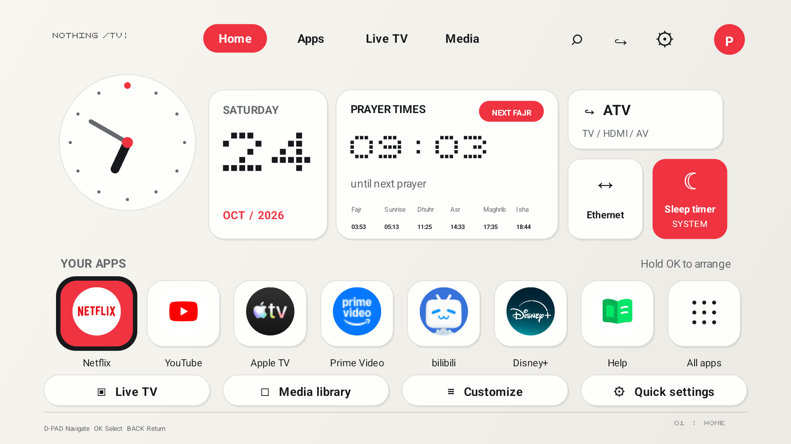](docs/screenshots/themes/nothing-light.png) | [](docs/screenshots/themes/glass-dark.png) |

| Neo Minimal | Industrial Mono |
| --- | --- |
| [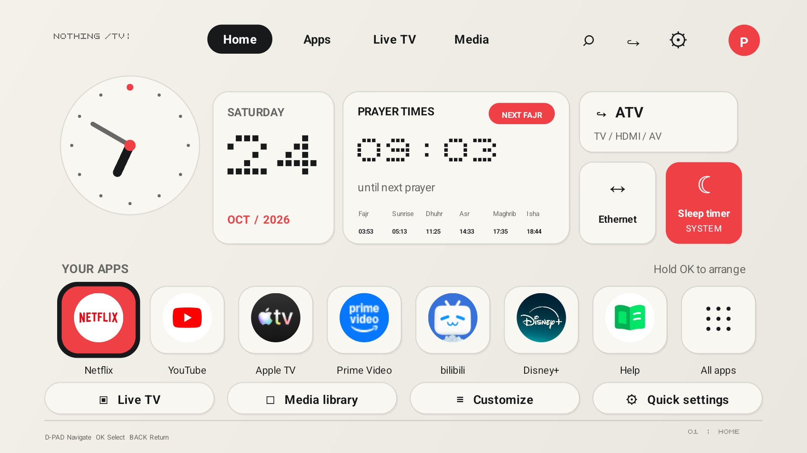](docs/screenshots/themes/neo-minimal.png) | [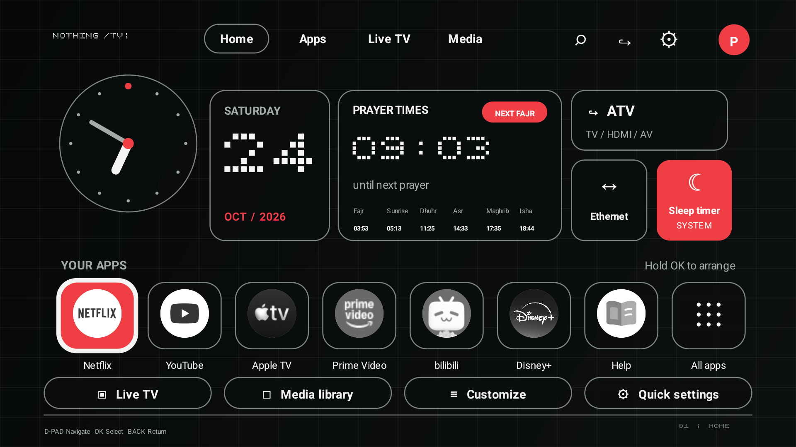](docs/screenshots/themes/industrial-mono.png) |

| Warm Premium | Playful Accent |
| --- | --- |
| [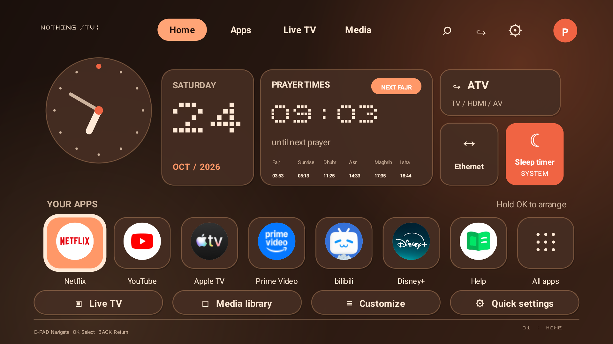](docs/screenshots/themes/warm-premium.png) | [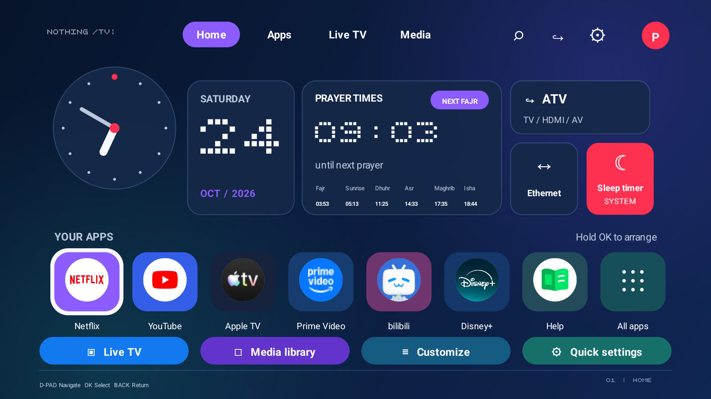](docs/screenshots/themes/playful-accent.png) |

### Theme selection and All Apps

| Appearance selector | Playful Accent in All Apps |
| --- | --- |
| [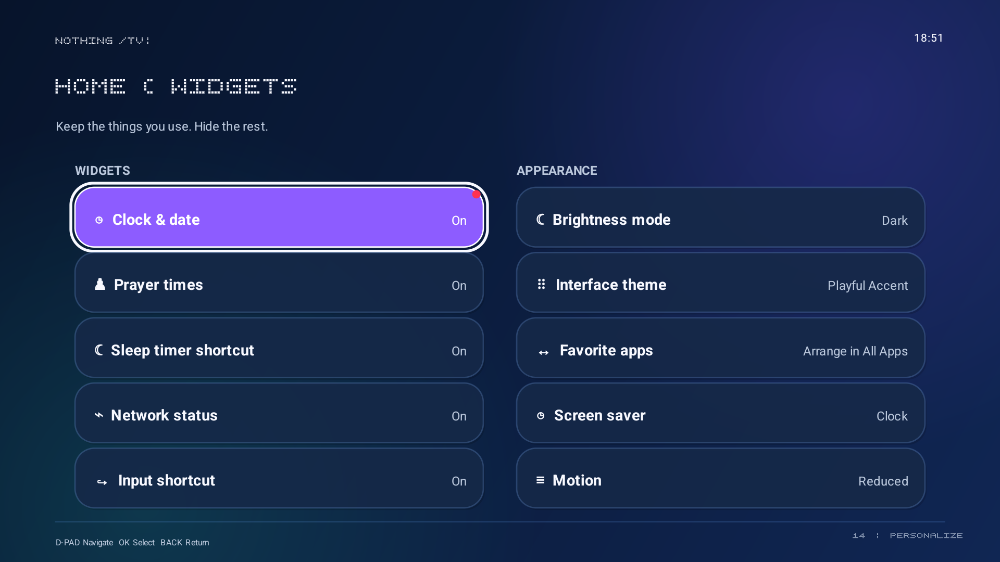](docs/screenshots/themes/appearance-selector.png) | [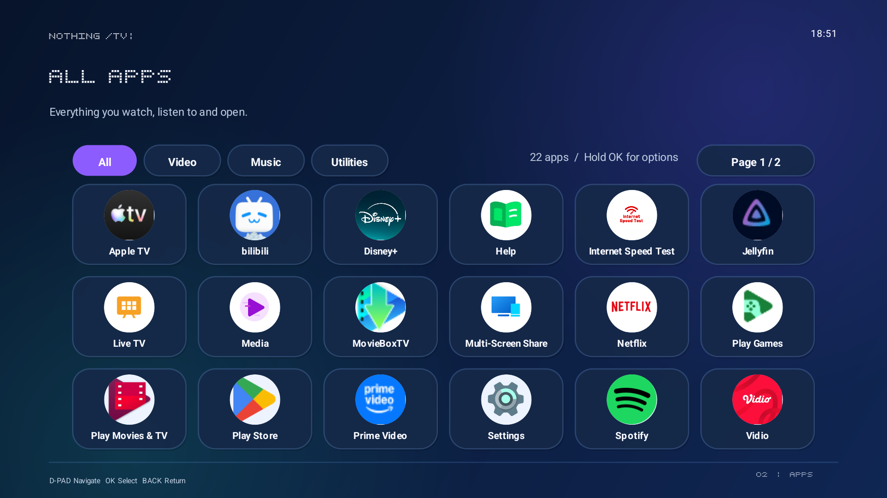](docs/screenshots/themes/playful-all-apps.png) |

## More screens

Captured at 1920×1080 from a real Android TV. Select any image to open the full-resolution reference; the original files are in [`docs/screenshots`](docs/screenshots).

| Home | All Apps |
| --- | --- |
| [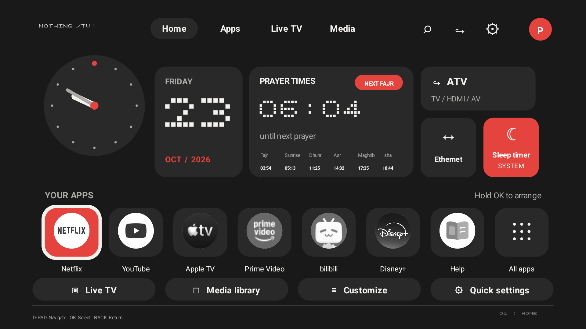](docs/screenshots/home.png) | [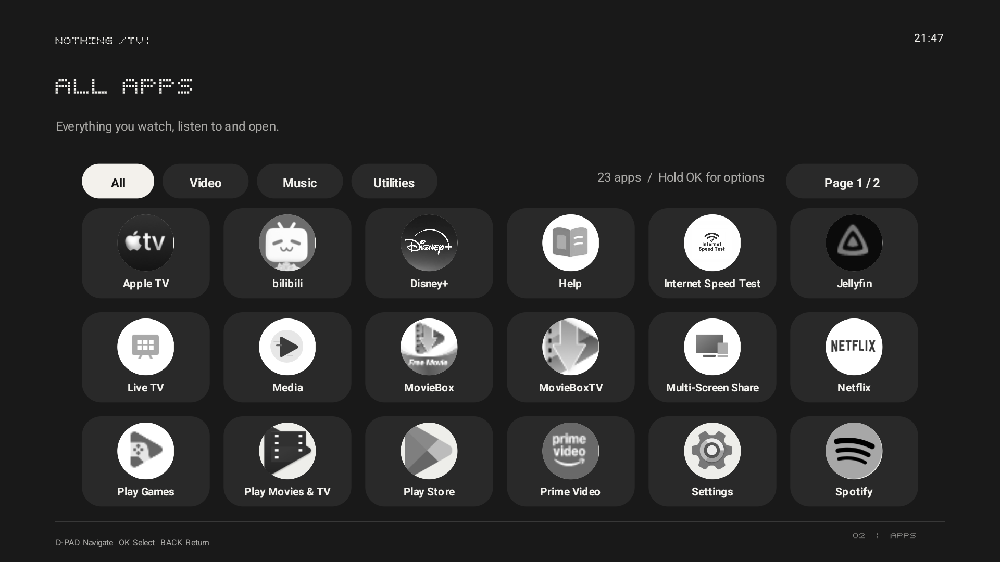](docs/screenshots/all-apps.png) |

| Settings | Quick Settings |
| --- | --- |
| [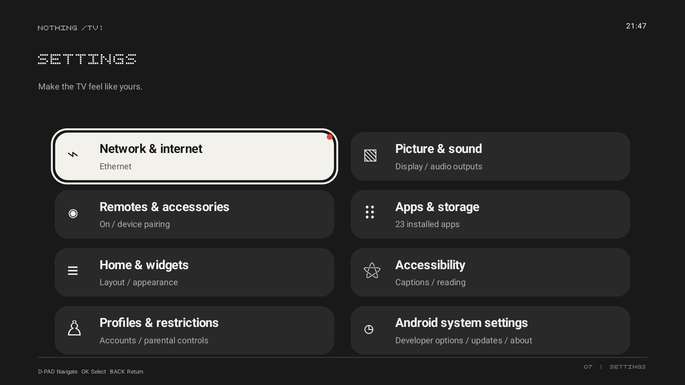](docs/screenshots/settings.png) | [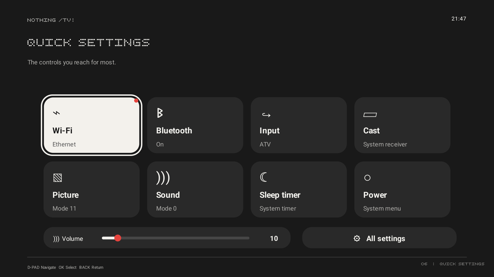](docs/screenshots/quick-settings.png) |

### Media Library

[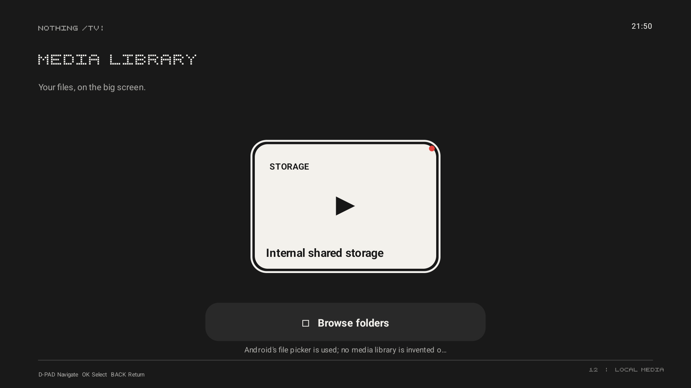](docs/screenshots/media-library.png)

## Requirements

- Android TV 8.0 / API 26 or newer
- JDK 17
- Android SDK Platform 34 and Build Tools 34
- ADB enabled on the TV for installation

Tested on a Changhong U55QCN1 running Android TV 14. Vendor firmware differs, so some system panels or remote buttons may not be exposed on another TV.

## Build

```sh
./gradlew --no-daemon testReleaseUnitTest lintRelease assembleRelease
```

The APK is generated locally at:

```text
app/build/outputs/apk/release/app-release.apk
```

Compiled APKs are intentionally not committed to this repository.

## Install safely

Connect the TV through Android's Wireless debugging or Network debugging, then run:

```sh
TV_HOST=<tv-ip> ./build-and-install.sh
```

Windows PowerShell:

```powershell
./build-and-install.ps1 -TvAddress <tv-ip>
```

The installer does **not** uninstall or disable the stock launcher or any system package. It builds from source, installs Nothing TV, starts it, and asks Android to make it Home. If the firmware ignores `set-home-activity`, select Nothing TV in the TV's Home-app/default-app settings.

To revert, select the original launcher in Android TV Settings. Keep ADB enabled until the new launcher has survived a reboot and the original Home can still be selected.

## Platform limitations

- HDMI switching, picture controls, audio controls, sleep timers, channel data, and pairing screens depend on APIs/actions published by the TV firmware.
- The launcher never invents channel lists, media entries, connection state, or device status.
- A physical Settings, Input, or Profile button only reaches the launcher when the firmware dispatches its Android key event. Injected ADB keys are not proof that a physical remote button works.
- Prayer calculations are performed locally and do not require network access. Confirm the selected city and calculation method against your local authority.

## Privacy

Nothing TV has no Internet permission and does not include analytics. Do not publish screenshots containing Wi-Fi names, account details, device names, serial numbers, or other personal identifiers.

## License and credits

MIT licensed. See [LICENSE](LICENSE).

- Original CleanYourTV launcher: Gathin
- NOTHING-style launcher fork and TV-specific UI work: angger43
- Outfit typeface: The Outfit Project Authors, licensed under SIL Open Font License 1.1; see [FONT-LICENSE-OFL.txt](FONT-LICENSE-OFL.txt)
